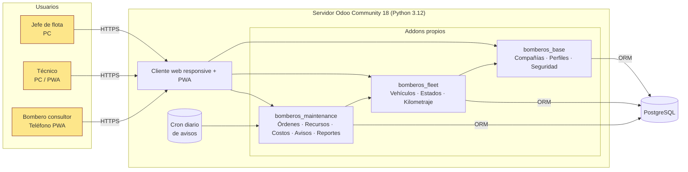
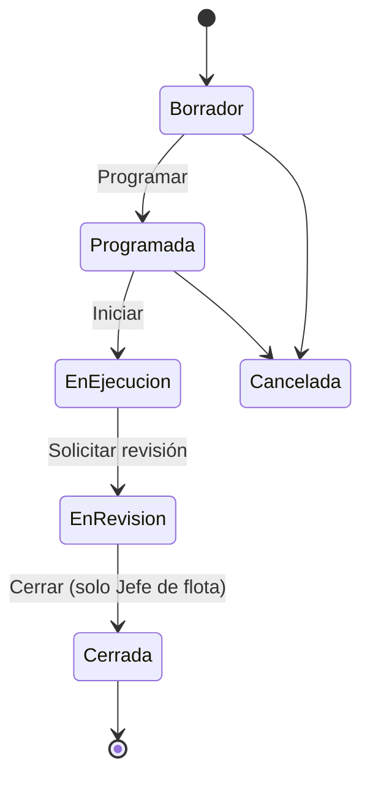

# 🚒 Sistema de Control y Seguimiento de Mantención de Vehículos de Emergencia — Cuerpo de Bomberos de Talcahuano

> **Proyecto APT · Capstone (PTY4614) · Ingeniería en Informática · Duoc UC, sede Padre Alonso de Ovalle · 2026**
> Solución web responsive / PWA construida sobre **Odoo Community 18 + PostgreSQL** mediante tres addons propios.

| Estado al 25-10-2026 | Detalle |
|---|---|
| Fase actual | **Fase 2 – Desarrollo** · Sprint 3 en curso (semanas 11–13) |
| Prototipo | Funcional en ambiente local (`bomberos_base`, `bomberos_fleet`, `bomberos_maintenance`) |
| Pruebas automatizadas | **9 aprobadas · 0 fallas · 0 errores** (ejecución del 14-10-2026, base `capstone`) |
| Pendiente | QA manual por perfil, PWA en dispositivo real, carga DEMO reproducible e implantación (Fase 3) |

---

## 📑 Índice

1. [Nombre del proyecto](#1-nombre-del-proyecto)
2. [Descripción](#2-descripción)
3. [Innovación y valor agregado](#3-innovación-y-valor-agregado)
4. [Alcance funcional (MVP)](#4-alcance-funcional-mvp)
5. [Requisitos no funcionales (RNF)](#5-requisitos-no-funcionales-rnf)
6. [Tecnologías utilizadas](#6-tecnologías-utilizadas)
7. [Arquitectura de la solución](#7-arquitectura-de-la-solución)
8. [Instrucciones para ejecutar el proyecto localmente](#8-instrucciones-para-ejecutar-el-proyecto-localmente)
9. [Integrantes del equipo y roles](#9-integrantes-del-equipo-y-roles)
10. [Metodología de trabajo](#10-metodología-de-trabajo)
11. [Documentación técnica, manuales y guías](#11-documentación-técnica-manuales-y-guías)
12. [Índice de evidencias del proyecto](#12-índice-de-evidencias-del-proyecto)
13. [Estado actual y próximos pasos](#13-estado-actual-y-próximos-pasos)
14. [Referencias](#14-referencias)

---

## 1. Nombre del proyecto

**Sistema de Control y Seguimiento de Mantención de Vehículos de Emergencia del Cuerpo de Bomberos de Talcahuano**
(repositorio: `gestion-flota-bomberos`).

---

## 2. Descripción

### ¿Qué hace?

Centraliza en una única plataforma web (accesible también desde el celular como PWA) la información de la flota de emergencia:

- Ficha identificatoria y técnica de cada vehículo, su **estado operativo** (disponible, en mantención, fuera de servicio), documentos y **kilometraje histórico**.
- **Órdenes de mantención preventivas y reactivas** con un flujo controlado: *Borrador → Programada → En ejecución → En revisión → Cerrada*.
- Registro de **materiales/repuestos y mano de obra** por orden, con cálculo automático de **costos**.
- **Avisos automáticos** de mantenciones próximas (30 días o 500 km), vencidas y pendientes de revisión.
- **Reportes** de estado de la flota y de costos por compañía, tipo y estado.

### ¿A quién va dirigido?

| Perfil | Uso principal |
|---|---|
| **Jefe de flota** | Visión global de todas las compañías, revisión y cierre de órdenes, reportes de costos. |
| **Técnico de mantención** | Registro de kilometraje, ejecución de órdenes, materiales y mano de obra de sus compañías. |
| **Bombero consultor** | Consulta (solo lectura) del estado y del historial de los vehículos de su compañía. |
| **Administrador de Bomberos** | Administración de compañías y acceso global a los registros del sistema. |

### ¿Qué problema resuelve?

Actualmente la información sobre el estado y las mantenciones de los vehículos de emergencia se encuentra dispersa y no se consulta de forma oportuna. Esto dificulta saber **qué unidad está disponible**, **cuándo corresponde su próxima mantención**, **qué se le hizo** y **cuánto costó**. En un servicio de emergencia, un carro bomba fuera de servicio sin aviso impacta directamente la capacidad de respuesta. El sistema entrega información **clara, confiable, trazable y oportuna** para apoyar la toma de decisiones sobre la flota.

---

## 3. Innovación y valor agregado

| Pregunta | Respuesta |
|---|---|
| **¿Qué problema resuelve?** | Elimina la dispersión de información de la flota: estado operativo, historial de kilometraje, mantenciones, recursos y costos quedan en un solo lugar, con avisos preventivos que evitan que una unidad quede fuera de servicio por una mantención olvidada. |
| **¿Qué lo hace diferente?** | • **Avisos híbridos por fecha *y* kilometraje** (30 días o 500 km) generados por un proceso diario, sin depender de correo/SMS.<br>• **Seguridad por compañía**: cada usuario solo ve los vehículos y órdenes de las compañías asignadas; solo el Jefe de flota cierra órdenes.<br>• **Inmutabilidad**: las órdenes en revisión, cerradas o canceladas y sus líneas de costo no se pueden editar, asegurando trazabilidad.<br>• **Validación de kilometraje**: rechaza lecturas inferiores a la máxima registrada.<br>• **Acceso móvil vía PWA** sobre el mismo servidor, sin desarrollar ni mantener una app nativa separada (alternativa autorizada por el docente). |
| **¿Qué valor agrega?** | • Disponibilidad de la flota visible en tiempo real para la jefatura.<br>• Costos de mantención consolidados por compañía, tipo y estado.<br>• Historial auditable de quién hizo qué y cuándo.<br>• Base para planificación preventiva en vez de reactiva. |
| **¿Por qué Odoo Community?** *(respuesta a la retroalimentación de Fase 1)* | Odoo es un framework ERP **modular**, de código abierto (licencia LGPL-3), con **ORM sobre PostgreSQL** (modelo relacional, integridad referencial), **control de acceso por grupos y reglas de registro**, vistas web responsive, tareas programadas (cron), framework de **pruebas automatizadas** y soporte PWA en su cliente web. Es ampliamente utilizado en la industria, lo que lo hace una plataforma probada. Esto permitió concentrar el esfuerzo en la lógica propia de Bomberos. |
| **¿Qué módulos se adaptan o crean?** | **No se modifica el código fuente de Odoo** ni se instalan las apps estándar *Fleet*, *Maintenance* o *Inventory/Stock*. Se construyeron **tres addons propios**: `bomberos_base`, `bomberos_fleet` y `bomberos_maintenance` (ver [Arquitectura](#7-arquitectura-de-la-solución)). |
| **¿Tiene manual técnico / guía de instalación?** | Sí. Ver [§11 Documentación técnica](#11-documentación-técnica-manuales-y-guías): requisitos y arquitectura, modelo de datos y diccionario, manual de usuario, instalación y despliegue, plan de QA e informe del modelo de datos. |
| **¿Tiene sección de RNF?** | Sí, en este README: [§5 Requisitos no funcionales](#5-requisitos-no-funcionales-rnf) (rendimiento, seguridad, disponibilidad, usabilidad, mantenibilidad, portabilidad, integridad y respaldo). |

---

## 4. Alcance funcional (MVP)

| ID | Requisito | Criterio de aceptación resumido | Addon |
|---|---|---|---|
| RF-01 | Compañías y perfiles | Acceso limitado a las compañías asignadas, salvo Jefe de flota y Administrador. | `bomberos_base` |
| RF-02 | Vehículos | Ficha técnica, patente, compañía, tipo, estado operativo, documentos y kilometraje. | `bomberos_fleet` |
| RF-03 | Historial de kilometraje | Fecha, km, usuario y observación; rechaza lecturas menores al máximo. | `bomberos_fleet` |
| RF-04 | Mantenciones preventivas y reactivas | Falla, diagnóstico, fecha/km objetivo, trabajo, responsable y estado. | `bomberos_maintenance` |
| RF-05 | Flujo de aprobación | Borrador → Programada → En ejecución → En revisión → Cerrada; solo Jefe de flota cierra. | `bomberos_maintenance` |
| RF-06 | Recursos y costos | Materiales y mano de obra por orden con subtotales y costo total (CLP). | `bomberos_maintenance` |
| RF-07 | Avisos | Próximas (30 días / 500 km), vencidas y pendientes de revisión; cron diario. | `bomberos_maintenance` |
| RF-08 | Reportes básicos | Estado de vehículos y costos por compañía/tipo/estado (pivot y gráfico). | `bomberos_maintenance` |
| RF-09 | Web móvil / PWA | Interfaz responsive e instalable; requiere Internet. | Cliente web Odoo |

**Fuera de alcance del MVP:** funcionamiento offline, aplicación nativa, notificaciones por correo/SMS y control de inventario de bodega.

---

## 5. Requisitos no funcionales (RNF)

> Los RNF se derivan de [01_Requisitos_y_arquitectura.docx](<Fase 2/Evidencias Proyecto/Evidencia de documentación/01_Requisitos_y_arquitectura.docx>), [04_Instalacion_y_despliegue.docx](<Fase 2/Evidencias Proyecto/Evidencia de documentación/04_Instalacion_y_despliegue.docx>) y [05_Plan_y_matriz_QA.docx](<Fase 2/Evidencias Proyecto/Evidencia de documentación/05_Plan_y_matriz_QA.docx>). La columna *Verificación* indica honestamente qué está comprobado y qué se validará en la etapa de QA (semanas 14–16).

| ID | Categoría | Requisito | Cómo se aborda | Verificación |
|---|---|---|---|---|
| RNF-01 | **Seguridad – control de acceso** | Cada usuario accede solo a los datos de sus compañías asignadas, según 4 perfiles jerárquicos. | Grupos de seguridad, `ir.model.access.csv` y reglas de registro (`rules.xml`) por compañía. |  UT-01, UT-02, UT-04, UT-05 aprobadas. |
| RNF-02 | **Seguridad – autorización de acciones** | Solo Jefe de flota/Administrador puede cerrar o cancelar órdenes. | Validación en la lógica del modelo de órdenes. |  UT-07 aprobada. |
| RNF-03 | **Seguridad – configuración y transporte** | Sin credenciales en el repositorio; acceso externo solo por HTTPS. | `odoo.conf` y entorno virtual excluidos en `.gitignore`; despliegue tras proxy HTTPS, usuarios con mínimo privilegio. |  `.gitignore` vigente · ⏳ HTTPS en implantación (Fase 3). |
| RNF-04 | **Integridad y trazabilidad** | Los registros cerrados no se alteran; el kilometraje nunca disminuye; se registra quién revisó y cuándo. | Bloqueo de edición en estados En revisión/Cerrada/Cancelada; restricciones ORM; campos de revisor y fecha. |  UT-03, UT-08, UT-09 aprobadas. |
| RNF-05 | **Rendimiento** | Navegación fluida de listas, fichas y reportes con la flota de Talcahuano; el cálculo de avisos no debe afectar la operación diaria. | Costos almacenados (campos calculados con `store`), índices de PostgreSQL vía ORM, avisos calculados por cron diario fuera de la interacción del usuario y sin duplicados. |  UT-06 (no duplicidad) · ⏳ Medición de tiempos de respuesta en QA. |
| RNF-06 | **Disponibilidad** | Sistema accesible vía web/PWA durante la operación; requiere conexión a Internet. | Servidor Odoo + PostgreSQL centralizado; política de respaldos de la base de datos definida para implantación. | ⏳ Se validará en el ambiente de implantación (Fase 3). |
| RNF-07 | **Usabilidad / responsive** | Interfaz usable desde escritorio y teléfono, en español, con menús según perfil. | Cliente web responsive de Odoo y PWA instalable; menús *Bomberos → Flota / Mantenciones*. | ⏳ QA-01 y QA-09 (PWA en dispositivo real) pendientes. |
| RNF-08 | **Mantenibilidad / modularidad** | Funcionalidad separada en módulos independientes, sin modificar el núcleo de Odoo. | Tres addons con dependencias explícitas (`base → fleet → maintenance`), pruebas por addon. |  Verificado: el core de Odoo no se edita. |
| RNF-09 | **Portabilidad** | Ejecutable en macOS, Linux o Windows con Python 3.12 y PostgreSQL. | Dependencias estándar de Odoo 18; configuración local por archivo. |  Ejecutado en ambiente local de desarrollo. |
| RNF-10 | **Respaldo y recuperación** | Respaldar la base antes de instalar/actualizar módulos y periódicamente en producción. | Procedimiento descrito en la guía de instalación; datos DEMO con prefijo para no confundirlos con datos reales. | ⏳ Plan de respaldo a formalizar en implantación. |

---

## 6. Tecnologías utilizadas

| Capa | Tecnología | Uso en el proyecto |
|---|---|---|
| **Lenguaje backend** | Python 3.12 | Modelos ORM, reglas de negocio, cron de avisos y pruebas automatizadas. |
| **Framework** | Odoo Community 18.0 (LGPL-3) | ORM, vistas, seguridad, tareas programadas, cliente web y PWA. |
| **Vistas / UI** | XML (vistas Odoo), QWeb, JavaScript/OWL y SCSS del cliente web | Formularios, listas, kanban, pivot, gráficos y menús. |
| **Base de datos** | PostgreSQL | Persistencia relacional de compañías, vehículos, kilometraje, órdenes, recursos, costos y avisos. |
| **Móvil** | PWA (Progressive Web App) del cliente web Odoo | Acceso instalable desde el teléfono; requiere conexión. |
| **Pruebas** | Framework de tests de Odoo (`--test-enable`, `--test-tags`) | Suite UT-01 a UT-09. |
| **Control de versiones** | Git + GitHub | Repositorio de código y evidencias. |
| **Entorno de desarrollo** | VS Code + debugpy (`.vscode/launch.json`) | Ejecución y depuración de Odoo 18. |
| **Diagramas** | Mermaid / PNG | Esquema relacional, arquitectura y flujo de mantención. |
| **Cloud** | No se utiliza en el prototipo actual | El ambiente de implantación (servidor con HTTPS/proxy) se define en la Fase 3. |

---

## 7. Arquitectura de la solución

### 7.1 Vista general



Diagrama oficial: [Arquitectura.png](<Fase 2/Evidencias Proyecto/Evidencia de documentación/Arquitectura.png>)

### 7.2 Módulos propios

| Addon | Responsabilidad | Modelos principales |
|---|---|---|
| `bomberos_base` | Compañías de Bomberos, moneda CLP, grupos (Administrador, Jefe de flota, Técnico, Bombero consultor) y asignación de compañías a usuarios. | `bomberos.company`, herencia de `res.users` |
| `bomberos_fleet` | Vehículos, documentos, estados operativos e historial de kilometraje. | `bomberos.vehicle`, `bomberos.vehicle.odometer` |
| `bomberos_maintenance` | Órdenes preventivas/reactivas, flujo de aprobación, materiales, mano de obra, costos, avisos diarios y reportes. | `bomberos.maintenance.order`, `bomberos.maintenance.material`, `bomberos.maintenance.labor`, `bomberos.maintenance.alert` |

### 7.3 Modelo de datos y flujo

- Modelo de datos: [Modelo_de_datos.png](<Fase 2/Evidencias Proyecto/Evidencia de documentación/Modelo_de_datos.png>) · Esquema relacional: [Esquema_relacional_Bomberos.png](<Fase 2/Evidencias Proyecto/Evidencias de sistema Aplicación de base de datos/Esquema_relacional_Bomberos.png>) ([fuente Mermaid](<Fase 2/Evidencias Proyecto/Evidencias de sistema Aplicación de base de datos/Esquema_relacional_Bomberos.mmd>))
- Flujo de una orden: [Flujo_de_mantencion.png](<Fase 2/Evidencias Proyecto/Evidencia de documentación/Flujo_de_mantencion.png>)



---

## 8. Instrucciones para ejecutar el proyecto localmente

> Guía completa: [04_Instalacion_y_despliegue.docx](<Fase 2/Evidencias Proyecto/Evidencia de documentación/04_Instalacion_y_despliegue.docx>).
> **Nota:** el 18-10-2026 se retiró del repositorio la carpeta `Software/` (contenía el código fuente completo de Odoo, ~44.000 archivos). Los addons propios se conservan en el historial (commit `9a9b9153`) y se volverán a versionar de forma selectiva en `Software/custom-addons/` durante el Sprint 3.

### 8.1 Requisitos previos

- Git, **Python 3.12** y **PostgreSQL** (14 o superior) en ejecución.
- macOS: `brew install python@3.12 postgresql@16` · Linux (Debian/Ubuntu): `sudo apt install python3.12 python3.12-venv postgresql libpq-dev`.

### 8.2 Pasos

```bash
# 1. Clonar el repositorio
git clone https://github.com/rod-saavedral/gestion-flota-bomberos.git
cd gestion-flota-bomberos

# 2. Recuperar los addons propios desde el historial (mientras no se re-versionen en HEAD)
git checkout 9a9b9153 -- Software/custom-addons
git restore --staged Software/custom-addons   # evita dejarlos preparados para commit por accidente

# 3. Descargar Odoo Community 18 (no se versiona en este repositorio)
git clone --depth 1 --branch 18.0 https://github.com/odoo/odoo.git Software/odoo-18.0

# 4. Crear el entorno virtual e instalar dependencias
cd Software
python3.12 -m venv .venv312
source .venv312/bin/activate
pip install -r odoo-18.0/requirements.txt

# 5. Crear un usuario de PostgreSQL para Odoo (ejemplo local)
createuser --createdb --pwprompt odoo
```

Crear `Software/odoo.conf` (**no se sube a Git**, está en `.gitignore`):

```ini
[options]
addons_path = odoo-18.0/addons,odoo-18.0/odoo/addons,custom-addons
db_host = localhost
db_port = 5432
db_user = odoo
db_password = <tu_contraseña_local>
http_port = 8069
```

```bash
# 6. Instalar los addons en una base de prueba (incluye dependencias y datos DEMO)
python odoo-18.0/odoo-bin -c odoo.conf -d capstone -i bomberos_maintenance --stop-after-init

# 7. Ejecutar el servidor
python odoo-18.0/odoo-bin -c odoo.conf
# Abrir http://localhost:8069 → menú Bomberos → Flota / Mantenciones
```

### 8.3 Comandos útiles

```bash
# Actualizar los addons después de cambios en el código
python odoo-18.0/odoo-bin -c odoo.conf -d capstone -u bomberos_base,bomberos_fleet,bomberos_maintenance --stop-after-init

# Ejecutar la suite de pruebas automatizadas (usar SOLO una base de prueba)
python odoo-18.0/odoo-bin -c odoo.conf -d capstone_test -i bomberos_maintenance \
  --test-enable --test-tags=/bomberos_base,/bomberos_fleet,/bomberos_maintenance --stop-after-init
```

- **VS Code:** *Run and Debug → "Odoo 18"* (usa [.vscode/launch.json](.vscode/launch.json) con el intérprete `Software/.venv312/bin/python`).
- **PWA:** desde el teléfono, abrir la URL del servidor (HTTPS) y elegir *"Agregar a pantalla de inicio"*.
- Los registros con prefijo **DEMO** son ficticios; para una base con datos reales, instalar sin datos de demostración y **respaldar antes** de instalar o actualizar.

---

## 9. Integrantes del equipo y roles

| Integrante | Rol Scrum | Responsabilidades principales | GitHub |
|---|---|---|---|
| **Rodrigo Antonio Saavedra Lara** | Product Owner / QA Funcional | Levantar y aclarar requerimientos, priorizar el Product Backlog, definir criterios de aceptación, diseñar y ejecutar QA funcional, validar incrementos, consolidar evidencias grupales y el repositorio. | `rod-saavedral` |
| **Benjamin Isaac Morales Barriga** | Scrum Master | Facilitar ceremonias Scrum, seguimiento de sprints, impedimentos, riesgos e hitos; control de la Carta Gantt; registro de actas de reunión; liderar implantación y cierre. | `BenjaMorales874` |
| **Eddie Jesús Cerpa Navarro** | Developer Odoo | Configurar el entorno técnico, desarrollar e integrar los addons (modelos ORM/PostgreSQL, vistas, seguridad, lógica de negocio), pruebas automatizadas y apoyo al despliegue. | `edisinh0` |

El detalle de tareas por integrante, reunión y fecha está en el **[Registro de reuniones y tareas del equipo](<Fase 2/Evidencias Proyecto/Evidencia de documentación/07_Evidencia_de_reuniones.docx>)**.

> **Registro de gestión:** contiene 19 reuniones de las Fases 1 y 2, con fechas confirmadas por Rodrigo Saavedra, acuerdos, tareas por rol y trazabilidad de entregas. Los commits y documentos citados respaldan los entregables; la confirmación de las reuniones se registra por separado en el documento.

---

## 10. Metodología de trabajo

Se utiliza **Scrum** (marco ágil), con un tablero Kanban para el seguimiento visual de tareas.

- **Artefactos:** Product Backlog priorizado (valor, esfuerzo, riesgo y tiempo), Sprint Backlog, Scrumboard, Burndown Chart, Impediment Log, Definition of Done y criterios de aceptación por historia.
- **Ceremonias:** Sprint Planning, reuniones de seguimiento cortas (15 min, dos veces por semana), Sprint Review y Sprint Retrospective. El [registro de reuniones](<Fase 2/Evidencias Proyecto/Evidencia de documentación/07_Evidencia_de_reuniones.docx>) presenta las sesiones registradas, sus acuerdos y el seguimiento de compromisos.
- **Definition of Done:** historia implementada en un addon propio, cumple sus criterios de aceptación, pruebas automatizadas en verde, revisada por el Product Owner y documentada.
- **Plantillas de seguimiento:** [06_Plantillas_de_evidencia.docx](<Fase 2/Evidencias Proyecto/Evidencia de documentación/06_Plantillas_de_evidencia.docx>).

### Planificación (18 semanas)

| Semanas | Fechas (2026) | Etapa | Lidera | Estado |
|---|---|---|---|---|
| S1 | 10-08 → 16-08 | Análisis del caso y mapa de actores | Rodrigo y Benjamin |  Completado |
| S2–S3 | 17-08 → 30-08 | Visión, historias de usuario, User Story Mapping y Product Backlog | Rodrigo y Benjamin |  Completado |
| S4–S5 | 31-08 → 13-09 | Cierre Fase 1 (Guía 1.5, presentación, formativa 1.4) | Equipo |  Completado |
| S6–S7 | 14-09 → 27-09 | Sprint 0 – Configuración Odoo/PostgreSQL/PWA (desplazado por cierre de Fase 1 y Fiestas Patrias) | Eddie |  Completado |
| S8 | 28-09 → 04-10 | Sprint 1 – Compañías, perfiles, vehículos, estados y kilometraje | Eddie |  Completado |
| S9–S10 | 05-10 → 18-10 | Sprint 2 – Mantenciones, flujo, recursos, costos y avisos · Informe de avance 2.5 (14-10) | Eddie |  Completado |
| S11–S13 | 19-10 → 08-11 | Sprint 3 – Reportes, carga DEMO reproducible, versionado de addons, README y evidencias | Eddie | 🔄 En curso |
| S14–S16 | 09-11 → 29-11 | QA manual, integración, PWA en dispositivo real y mejoras | Rodrigo | ⏳ Planificado |
| S17–S18 | 30-11 → 13-12 | Implantación, informe final, video demo y defensa | Benjamin | ⏳ Planificado |

---

## 11. Documentación técnica, manuales y guías

| Documento | Tipo | Contenido |
|---|---|---|
| [01_Requisitos_y_arquitectura.docx](<Fase 2/Evidencias Proyecto/Evidencia de documentación/01_Requisitos_y_arquitectura.docx>) | Documento técnico | RF del MVP, arquitectura, addons, roles/permisos y reglas de negocio. |
| [02_Modelo_de_datos_y_diccionario.docx](<Fase 2/Evidencias Proyecto/Evidencia de documentación/02_Modelo_de_datos_y_diccionario.docx>) | Manual técnico | Entidades ORM, campos, tipos, relaciones y restricciones. |
| [03_Manual_de_usuario.docx](<Fase 2/Evidencias Proyecto/Evidencia de documentación/03_Manual_de_usuario.docx>) | Manual de usuario | Operación diaria: kilometraje, órdenes, avisos, reportes y perfiles. |
| [04_Instalacion_y_despliegue.docx](<Fase 2/Evidencias Proyecto/Evidencia de documentación/04_Instalacion_y_despliegue.docx>) | Guía de instalación/despliegue | Requisitos, ejecución local, instalación/actualización de addons, seguridad. |
| [05_Plan_y_matriz_QA.docx](<Fase 2/Evidencias Proyecto/Evidencia de documentación/05_Plan_y_matriz_QA.docx>) | Plan de pruebas | UT-01…UT-09 (aprobadas) y casos manuales QA-01…QA-09. |
| [06_Plantillas_de_evidencia.docx](<Fase 2/Evidencias Proyecto/Evidencia de documentación/06_Plantillas_de_evidencia.docx>) | Plantillas Scrum | Backlog, Sprint Backlog, Scrumboard, Burndown, Impediment Log, Review/Retro, incidencias QA. |
| [07_Evidencia_de_reuniones.docx](<Fase 2/Evidencias Proyecto/Evidencia de documentación/07_Evidencia_de_reuniones.docx>) | Registro de reuniones y tareas | 19 actas, calendario, acuerdos, decisiones, tareas por integrante y trazabilidad de entregas a commits. |
| [Informe_modelo_datos_Bomberos.md](<Fase 2/Evidencias Proyecto/Evidencias de sistema Aplicación de base de datos/Informe_modelo_datos_Bomberos.md>) ([PDF](<Fase 2/Evidencias Proyecto/Evidencias de sistema Aplicación de base de datos/Informe_modelo_datos_Bomberos.pdf>)) | Informe técnico BD | Análisis del modelo relacional implementado en PostgreSQL. |
| [§5 de este README](#5-requisitos-no-funcionales-rnf) | RNF | Rendimiento, seguridad, disponibilidad, usabilidad, mantenibilidad, portabilidad, integridad y respaldo. |

---

## 12. Índice de evidencias del proyecto

```text
gestion-flota-bomberos/
├── README.md                                   ← este documento
├── Fase 1/                                     Definición del proyecto (S1–S5)
│   ├── Evidencias Grupales/
│   └── Evidencias Individuales/
└── Fase 2/                                     Desarrollo del proyecto (S6–S13)
    ├── Evidencias Grupales/
    ├── Evidencias Individuales/
    └── Evidencias Proyecto/
        ├── Presentacion Proyecto.pptx
        ├── Evidencia de documentación/         ← documentación técnica + registro de reuniones
        └── Evidencias de sistema Aplicación de base de datos/
```

### Fase 1 — Definición del proyecto

| Tipo | Evidencia | Descripción |
|---|---|---|
| Grupal | [1.4_APT122_FormativaFase1.docx](<Fase 1/Evidencias Grupales/1.4_APT122_FormativaFase1.docx>) | Evaluación formativa de Fase 1. |
| Grupal | [1.5_GuiaEstudiante_Fase1_Definicion_Proyecto_APT.docx](<Fase 1/Evidencias Grupales/1.5_GuiaEstudiante_Fase1_Definicion_Proyecto_APT.docx>) | Definición del proyecto: fundamentación, objetivos, metodología, evidencias, plan de trabajo y Carta Gantt. |
| Grupal | [Presentacion Proyecto.pptx](<Fase 1/Evidencias Grupales/Presentacion Proyecto.pptx>) | Presentación de la definición del proyecto. |
| Grupal | [PLANILLA DE EVALUACIÓN FASE 1.xlsx](<Fase 1/Evidencias Grupales/PLANILLA DE EVALUACIÓN FASE 1.xlsx>) | Planilla de evaluación de Fase 1. |
| Individual – Rodrigo | [1.1 Autoevaluación de competencias](<Fase 1/Evidencias Individuales/Saavedra_Lara_Rodrigo_Antonio1.1_APT122_AutoevaluacionCompetenciasFase1.docx>) · [1.2 Diario de reflexión](<Fase 1/Evidencias Individuales/Saavedra_Lara_Rodrigo_Antonio1.2_APT122_DiarioReflexionFase1.docx>) · [1.3 Autoevaluación](<Fase 1/Evidencias Individuales/Saavedra_Lara_Rodrigo_Antonio1.3_APT122_AutoevaluaciónFase1.docx>) | Evidencias individuales. |
| Individual – Benjamin | [1.1 Autoevaluación de competencias](<Fase 1/Evidencias Individuales/Morales_Barriga_Benjamin_Morales1.1_APT122_AutoevaluacionCompetencias.docx>) · [1.2 Diario de reflexión](<Fase 1/Evidencias Individuales/Morales_Barriga_Benjamin_Morales1.2_APT122_DiarioReflexion.docx>) · [1.3 Autoevaluación](<Fase 1/Evidencias Individuales/Morales_Barriga_Benjamin_Morales1.3_APT122_AutoevaluaciónFase1.docx>) | Evidencias individuales. |
| Individual – Eddie | [1.1 Autoevaluación de competencias](<Fase 1/Evidencias Individuales/Cerpa_Navarro_Eddie_Jesus1.1_APT122_AutoevaluacionCompetenciasFase1.docx>) · [1.2 Diario de reflexión](<Fase 1/Evidencias Individuales/Cerpa_Navarro_Eddie_Jesus1.2_APT122_DiarioReflexionFase1.docx>) · [1.3 Autoevaluación](<Fase 1/Evidencias Individuales/Cerpa_Navarro_Eddie_Jesus1.3_APT122_AutoevaluacionFase1.docx>) · [1.5 Guía](<Fase 1/Evidencias Individuales/Cerpa_Navarro_Eddie_Jesus1.5_APT122_GuiaEstudianteFase1.docx>) | Evidencias individuales. |

### Fase 2 — Desarrollo del proyecto

| Tipo | Evidencia | Descripción |
|---|---|---|
| Grupal | [2.4_GuiaEstudiante_Fase2_DesarrolloProyecto APT.docx](<Fase 2/Evidencias Grupales/2.4_GuiaEstudiante_Fase2_DesarrolloProyecto APT.docx>) | Monitoreo del plan de trabajo y ajustes (corte 23-09-2026). |
| Grupal | [2.5_APT122_Sumativa Avance Fase2.docx](<Fase 2/Evidencias Grupales/2.5_APT122_Sumativa Avance Fase2.docx>) | Informe de avance con corte al 14-10-2026. |
| Grupal | [PLANILLA DE EVALUACION AVANCE FASE 2.xlsx](<Fase 2/Evidencias Grupales/PLANILLA DE EVALUACION AVANCE FASE 2.xlsx>) | Planilla de evaluación del avance de Fase 2. |
| Individual | [Rodrigo – 2.1 Diario](<Fase 2/Evidencias Individuales/Saavedra_Lara_Rodrigo_Antonio_2.1_APT122_DiarioReflexionFase2.docx>) · [Benjamin – 2.1 Diario](<Fase 2/Evidencias Individuales/Morales_Barriga_Benjamin_Isaac_2.1_APT122_DiarioReflexionFase2.docx>) · [Eddie – 2.1 Diario](<Fase 2/Evidencias Individuales/Cerpa_Navarro_Eddie_Jesus_2.1_APT122_DiarioReflexionFase2.docx>) | Diarios de reflexión de Fase 2. |
| Proyecto | [Presentacion Proyecto.pptx](<Fase 2/Evidencias Proyecto/Presentacion Proyecto.pptx>) | Presentación/mockup del prototipo. |
| Proyecto – Documentación | [Evidencia de documentación/](<Fase 2/Evidencias Proyecto/Evidencia de documentación>) | Documentos 01–06 (ver [§11](#11-documentación-técnica-manuales-y-guías)) y diagramas de arquitectura, modelo de datos y flujo. |
| **Proyecto – Reuniones** | **[07_Evidencia_de_reuniones.docx](<Fase 2/Evidencias Proyecto/Evidencia de documentación/07_Evidencia_de_reuniones.docx>)** | **Registro de 19 reuniones (agosto–octubre 2026), acuerdos, decisiones, impedimentos y tareas por integrante según su rol. Incluye fechas confirmadas por Rodrigo Saavedra y trazabilidad documental de entregas.** |
| Proyecto – Base de datos | [Evidencias de sistema Aplicación de base de datos/](<Fase 2/Evidencias Proyecto/Evidencias de sistema Aplicación de base de datos>) | Esquema relacional (PNG/Mermaid) e informe del modelo de datos (MD/DOCX/PDF). |
| Código fuente | Commit [`9a9b9153`](https://github.com/rod-saavedral/gestion-flota-bomberos/commit/9a9b9153) → `Software/custom-addons/` | Addons `bomberos_base`, `bomberos_fleet`, `bomberos_maintenance` con sus pruebas. |

---

## 13. Estado actual y próximos pasos

**Logrado:** tres addons propios funcionales, modelo de datos en PostgreSQL, perfiles y seguridad por compañía, flujo completo de órdenes, costos, avisos, datos DEMO, 9 pruebas automatizadas aprobadas y documentación técnica 01–07.

**Próximos pasos (Sprint 3 y Fase 3):**

1. Re-versionar selectivamente `Software/custom-addons/` (sin el core de Odoo, entorno virtual ni `odoo.conf`).
2. Carga reproducible de datos DEMO y reportes pivot/gráfico revisados.
3. Ejecutar y registrar QA-01 a QA-09 con los cuatro perfiles y la PWA en un teléfono real.
4. Actualizar la Guía 2.4 y la Carta Gantt con el avance real.
5. Implantación en el ambiente definido (HTTPS, respaldos), informe final, video demo y defensa.

---

## 14. Referencias

- Duoc UC. (2026a). *Guía Estudiante – Definición Proyecto APT, Fase 1*. Asignatura Capstone.
- Duoc UC. (2026b). *Proyecto APT – Escuela de Ingeniería Informática, Propuesta n.º 2: Sistema de Control y Seguimiento de Mantención de Vehículos de Emergencia del Cuerpo de Bomberos de Talcahuano*.
- Duoc UC. (2026c). *Guía Estudiante – Desarrollo Proyecto APT, Fase 2*. Asignatura Capstone.
- Odoo S.A. (2024). *Odoo 18.0 Developer Documentation*. https://www.odoo.com/documentation/18.0/developer.html
- The PostgreSQL Global Development Group. (2024). *PostgreSQL Documentation*. https://www.postgresql.org/docs/
- Schwaber, K. y Sutherland, J. (2020). *La Guía de Scrum*. https://scrumguides.org/
